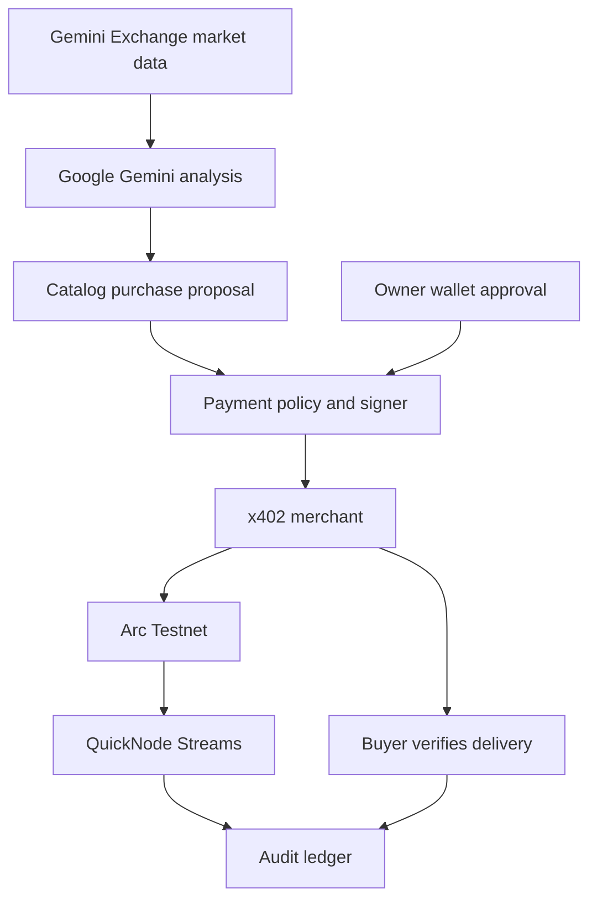

# Verity

**An AI agent that buys evidence to clarify how prediction markets resolve.**

Verity reads a prediction-market contract, identifies missing evidence that could affect its resolution, and proposes a specific research purchase. A separate payment service enforces the owner’s spending rules. The audit ledger shows whether the merchant delivered the quoted evidence and whether the payment settled.

> [!NOTE]
> **UBC 2026 hackathon project · Planned MVP.** The demo scope is read-only market analysis, one allowlisted merchant, and USDC settlement on Arc Testnet. The merchant may serve a labeled fixture while settlement and reconciliation run live. Setup commands and a hosted demo have yet to be documented.

## What the demo shows

1. **Find a gap.** Read a Gemini Exchange contract and highlight a specific question about its resolution rules or sources. For example, a contract might leave the cutoff time unclear.
2. **Price the evidence.** Match the gap to a catalog item. In the demo, the merchant quotes **0.05 testnet USDC** for a versioned source excerpt.
3. **Apply the spending policy.** Check the quote, reserve funds, and obtain the owner’s wallet signature when the price requires it.
4. **Verify the outcome.** Compare the received bytes with the signed merchant receipt and the original quote. Match the payment to the Arc transaction using QuickNode Streams.

## Architecture



The model proposes a catalog item and explains why it matters. The payment service holds the signer and derives the merchant endpoint, recipient, asset, network, and amount from the allowlisted catalog and validated quote.

### Market analysis

| Interface | Responsibility |
| --- | --- |
| `get_risk_analysis(contract_id)` → `RiskAnalysisV1` | Normalize the market snapshot and assess resolution ambiguity, source quality, liquidity, and dependence for multi-leg contracts. Record citations, uncertainty, and the snapshot timestamp and hash. |
| `generate_purchase_request(risk_analysis)` → `PurchaseProposalV1` or `null` | Match a material evidence gap to a catalog item or log why no purchase was proposed. The proposal identifies the contract, gap, item, parameters, rationale, and maximum spend in USDC base units. |

Scores range from 1 (low observed risk) to 5 (material risk supported by evidence). Missing or inapplicable data produces a `null` score with a reason. The dashboard displays observed prices and timestamps separately from risk scores and preserves the original analysis so changes after delivery can be traced.

### Spending policy

| Quote amount | Decision |
| --- | --- |
| 0.01–0.10 USDC | Automatic after shared policy checks |
| 0.11–0.50 USDC | Automatic for a material unresolved gap with a catalog match and no suitable free or cached evidence |
| 0.51–2.00 USDC | Requires a one-use, expiring EIP-712 approval from the enrolled owner wallet |
| Above 2.00 USDC | Rejected |

Every purchase checks the pause state, allowlists, quote expiry, duplicates, and the **25 USDC mission budget**, which includes confirmed spend and outstanding reservations. The service groups proposals by contract and evidence gap to prevent splitting a purchase across quotes. ElevenLabs can explain a proposed purchase by phone or browser voice. Authorization comes from the owner’s wallet signature.

The policy is enforced by the payment service and uses a dedicated, low-balance testnet signer. A compromised signer could bypass the service. Pausing blocks new signatures, and issued signatures remain valid until expiry or verified cancellation.

### Payment and delivery

The merchant returns an HTTP `402` quote that pins the recipient, price, expiry, content type, and digest of the evidence. The payment service reserves funds and records the canonical `ResearchRequestV1` before signing. It binds the request to the EIP-3009 authorization through the nonce.

```text
requestHash = keccak256(UTF8(JCS(ResearchRequestV1)))
nonce       = keccak256(UTF8("verity:eip3009:nonce:v1") || requestHash || salt)
```

The salt is 32 random bytes, and concatenation uses raw bytes. The merchant rebuilds the request from the actual route and body, checks the derived nonce and payment fields before settlement, and treats repeat submissions for the same authorization as retries. If submission times out, the service tracks the existing nonce or transaction until it can resolve the outcome.

After settlement, the merchant returns the quoted evidence and a signed `DeliveryReceiptV1`. The buyer verifies the receipt against the pinned merchant key and hashes the raw response before parsing. A matching digest establishes that the buyer received the quoted bytes. The analysis still has to assess whether the evidence is credible and relevant.

### Settlement audit

The planned QuickNode Stream sends Arc Testnet block receipts to `/webhooks/quicknode`, filtering for relevant USDC `AuthorizationUsed` or `Transfer` logs. The receiver verifies the webhook signature, deduplicates events, and accounts for chain reorganizations. It matches the payer and authorization nonce with the exact recipient and amount in the same transaction, then waits for finality.

| Evidence observed | Ledger outcome |
| --- | --- |
| Confirmed payment, valid signed receipt, and matching response bytes | Reconciled |
| Confirmed payment with no verified delivery by the deadline | Paid, delivery missing |
| Verified delivery with no confirmed matching payment by the deadline | Delivered, payment unconfirmed |
| Inconsistent payment fields, invalid receipt, or wrong digest | Mismatch |
| An extra settlement or a transfer with no matching purchase | Duplicate or unmatched payment |

## Setup and verification

The integration plan uses Arc Testnet (chain ID `5042002`) and USDC at `0x3600000000000000000000000000000000000000`.

1. **Start with a fixture.** Share one timestamped market snapshot, one catalog item, and one request schema across the analyst, payment service, and merchant. Label fixture data in the demo.
2. **Test a purchase locally.** Confirm both sides derive the same request hash and nonce. Alter a bound request field and confirm rejection. Alter the response bytes and confirm the ledger flags the mismatch.
3. **Verify testnet settlement.** Fund the test payer, confirm facilitator support, and run one Arc transfer. Check that its authorization and transfer logs match the request before wiring QuickNode.
4. **Connect the live services.** Configure the Gemini Exchange feed, Google Gemini, the merchant and facilitator, Arc RPC, the QuickNode signing secret, the enrolled owner wallet, and ElevenLabs if using voice. Store credentials in the runtime environment.
5. **Record the demo.** Show one reconciled purchase, one quote that requires owner approval, and one tampered request rejected before settlement. Also check that concurrent reservations respect the budget and retries do not create a second transfer.

## Team workstreams

| Workstream | Handoff |
| --- | --- |
| Market intelligence | Normalized contract snapshot and cited `RiskAnalysisV1` |
| Purchase decisions | `PurchaseProposalV1`, decision reasons, and policy fixtures |
| Merchant and demo | Catalog, x402 quote, versioned evidence, and signed delivery receipt |
| Payments and security · Decong | Request binding, reservations, approval verification, settlement, and reconciliation |

## References

- [Gemini Exchange prediction-market events](https://developer.gemini.com/rest-api/prediction-markets/events/list-events) and [Google Gemini structured output](https://ai.google.dev/gemini-api/docs/structured-output)
- [x402 exact EVM scheme](https://github.com/x402-foundation/x402/blob/main/specs/schemes/exact/scheme_exact_evm.md), [EIP-3009](https://eips.ethereum.org/EIPS/eip-3009), and [JSON Canonicalization Scheme](https://www.rfc-editor.org/rfc/rfc8785.html)
- [Arc Testnet explorer](https://explorer.testnet.arc.io/), [Circle faucet](https://faucet.circle.com/), and [QuickNode webhook verification](https://www.quicknode.com/docs/streams/destinations/webhooks)
- [ElevenLabs phone integration](https://elevenlabs.io/docs/eleven-agents/phone-numbers/twilio-integration/native-integration/) and [UBC 2026 Devpost](https://ubc-hackathon-2026.devpost.com/)

